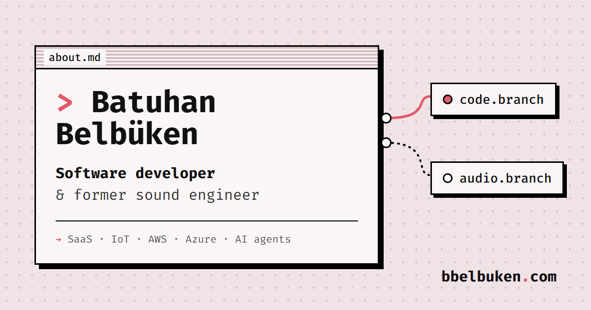

# bbelbuken.com

The portfolio of Batuhan Belbüken: a canvas of retro windows you connect with patch cables, and **agent.sh**, an LLM agent that answers questions about him and opens those windows for you.

**Live:** [bbelbuken.com](https://bbelbuken.com)



## agent.sh

A chat window on the canvas. Ask "show me his fashion films" and it replies, opens `fashion.mp4`, draws the wire to it and moves the camera there.

```
Browser (AgentTerminal.tsx)
  │  POST /api/chat
  ▼
Cloudflare Worker (worker/index.ts)
  ├─ origin check, rate limit, input limits
  ├─ system prompt built from the same data the page shows
  ├─ one Workers AI call (Llama 4 Scout)
  └─ "ACTION: open_node fashion" cut from the reply, checked against a whitelist
  ▼
{ reply, actions }  →  the browser runs the validated actions
```

- **Actions:** the model can open a window, open contact.sh, show the message form or offer the CV. Anything else it writes is only ever shown as text.
- **Abuse limits:** origin checks, 10 chats and 2 sent messages per minute per IP, capped input, and a whitelist that holds even if a prompt injection fools the model.
- **Leaving a message:** the visitor writes and sends it through a form, delivered with Cloudflare Email Routing. The model never writes or sends email.
- **Chat history:** questions and answers go to Cloudflare D1 for 90 days. No IPs or cookies, and emails and phone numbers are masked before they are stored.
- **Weekly review:** a cron job emails usage numbers and an LLM's review of the week's chats, pointing out weak answers and what to fix.

### Design decisions

| Decision | Why |
|---|---|
| An `ACTION:` line instead of native tool calling | Native tools needed a second call that often came back empty, and doubled latency. One call behaves the same on every model, and the contract is enforced in code. |
| No RAG | The whole profile is about 2k tokens and fits in the system prompt. A vector database would fetch text that is already in the context. |
| JSON instead of streaming | Replies are short and actions must be validated before the browser runs them. The terminal still prints the reply character by character. |
| One source of truth | The windows and the prompt read the same data files, so the agent can't drift from what the page shows. |

More detail, including model comparisons, safety and cost, is in [docs/ai-agent.md](docs/ai-agent.md).

## The canvas

- Drag a cable from a port to open the next window. Pan and zoom with mouse or touch.
- Cables are Bézier curves on a single SVG overlay, updated outside React's render cycle to keep dragging smooth.
- Spotify and YouTube embeds load only when someone presses play.
- Themes and wallpapers are in control.md.

## Stack

- **Site:** React, TypeScript, Vite, Tailwind CSS, Zustand, Framer Motion
- **Backend:** Cloudflare Workers with static assets, Workers AI, D1, Email Routing, cron triggers
- **Media:** Cloudflare R2, Spotify and YouTube embeds

## Run it locally

```bash
npm install
npx wrangler login       # once; Workers AI runs on Cloudflare even in dev
npx wrangler d1 migrations apply agent-chats --local
npm run dev:api          # builds the site, runs the Worker on :8787
npm run dev              # Vite on :5173, proxies /api to :8787
```

`npm run dev` alone is enough for the site without the agent. Videos need `VITE_MEDIA_BASE`, see [docs/media-setup.md](docs/media-setup.md).

Pushing to `main` deploys through Cloudflare Workers Builds. New D1 migrations aren't applied by the deploy; run them with `--remote`.

## Project layout

```
src/components/   canvas, windows and the agent.sh terminal
src/data/         profile, releases and videos: what the page and the agent read
src/stores/       Zustand stores for the graph, camera, theme and UI
worker/           chat API, prompt, message form, chat history, weekly digest
migrations/       D1 schema
docs/             agent architecture, media setup, security notes
```
